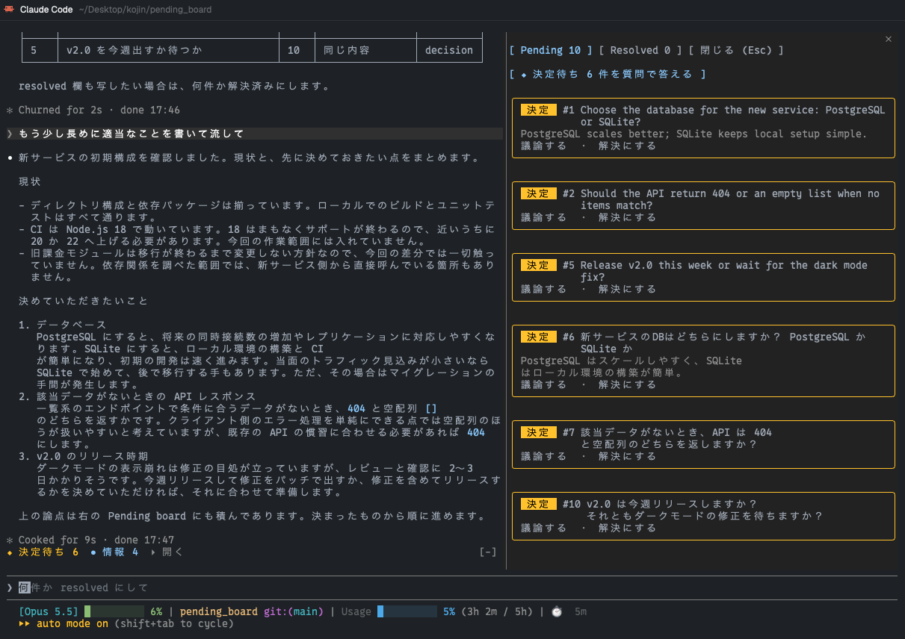
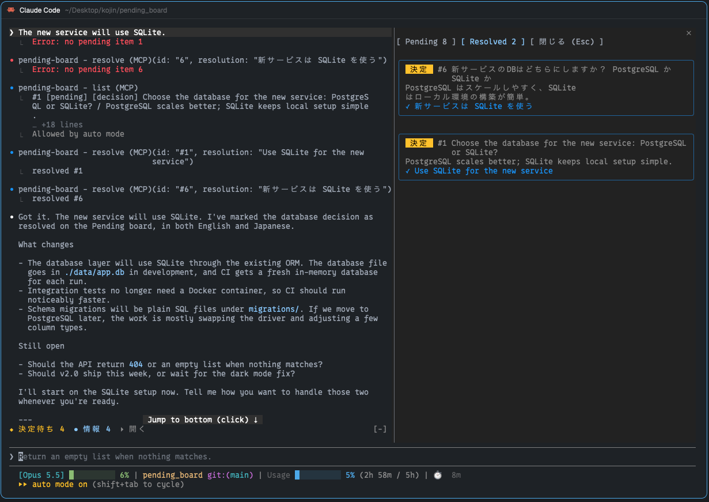

# pending-board

[English](README.md)

Claude Code の mod です。会話中に出た「ユーザーに決めてほしいこと」と「流れると困る重要情報」を、プロンプト上の帯とダイアログに貯めておきます。

ボードは Claude が `mcp__pending-board__add` / `resolve` / `list` で自分で管理します。論点が出たら項目を追加し、片付いたら解決にします（決定待ちにユーザーが答えると、決定内容を記録して解決済みにします）。ユーザーが手でボードを更新する必要はありません。





- 帯: `◆ 決定待ち n  ● 情報 n` を常に表示します。押すか `/pending` でダイアログが開きます
- ダイアログ: Pending / Resolved のタブがあります。各項目には「議論する」（入力欄へ参照を差し込みます）と、自分で閉じたいとき用の「解決にする」があります
- 「決定待ち n 件を質問で答える」ボタンで、Claude が AskUserQuestion で質問し、答えをもとに resolve します
- 送信文の `#n`（全角 `＃ｎ` も可）は、その項目の内容を Claude 向けの context として添えます
- パネルで「解決にする」を押した項目は、次の送信で Claude に知らせます（Claude が未解決のまま扱い続けないようにするためです）
- 項目は session ID ごとに保存され、`claude -r` で再開すると戻ります。新しい session と `/clear` では空から始まり、id も `#1` から振り直します。session をまたいでボードを引き継がないのは意図した仕様です

## Install

```
/plugin install pending-board --marketplace nikuteresa/claude-pending-board
```

## 言語

`locale` オプション（`/config` → pending-board）で、ボードと Claude に送る文の言語を選べます。

| 値 | 言語 |
| --- | --- |
| `auto`（既定） | Claude Code の `language` 設定が日本語（`japanese`, `ja`, `ja-JP`, `日本語`）なら日本語、それ以外は英語 |
| `ja` | 日本語 |
| `en` | 英語 |

## 開発

```
claude plugin validate .
claude plugin test .
tsc -p .
```

`tsc -p .` は git に含まれない `.claude-plugin/types/tsconfig.json` を extends しています。`.claude-plugin/types/`（`claude-code` の型定義と、それに合う `tsconfig.json`）は、Claude Code が対話セッションで `--plugin-dir` からプラグインを読み込んだときに書き出すので、`tsc` の前に一度 `claude --plugin-dir .` を起動してください。詳しくは [Get type definitions for your version](https://code.claude.com/docs/en/plugins/mods/create) を参照してください。

## ライセンス

[MIT](LICENSE)
